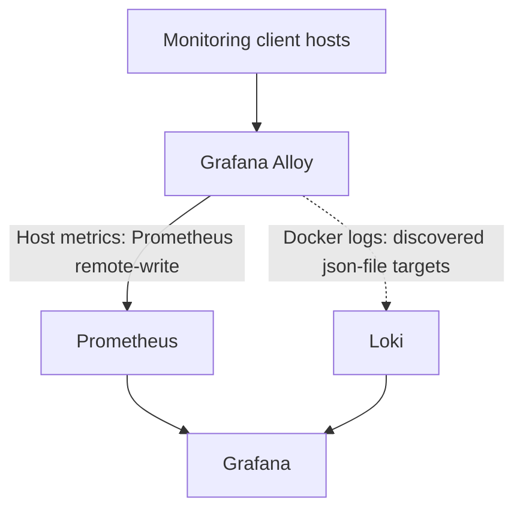

# Infrastructure Observability Stack

An Ansible-driven observability stack for infrastructure and Docker workloads using **Grafana, Prometheus, Loki, and Grafana Alloy**.

> [!IMPORTANT]
> **Single Instance is the implemented deployment profile.** High Availability (HA) and High Traffic / Scale-out are planned and are not currently deployable.

## 🚀 Quick Start

### Prerequisites

- Linux workstation: Ubuntu, Debian, or Kali Linux; or macOS.
- Python 3, Ansible Core, Git, and OpenSSH client.
- SSH access and sudo/become privileges on target hosts.
- Supported Debian targets: Bullseye, Bookworm, or Trixie.
- Network connectivity between monitoring clients and the monitoring server.

### Deploy Single Instance

Clone the repository:

    git clone git@github.com:wawangholanda/infrastructure-observability-stack.git
    cd infrastructure-observability-stack

Start the guided setup:

    ./quick-start.sh

Choose **Single Instance (monitoring server + client lab)** and follow the prompts for configuration, SSH authentication, and optional client registration.

The setup validates the lab configuration and secrets, checks playbook syntax, verifies SSH connectivity, and runs preflight checks before deployment.

> [!WARNING]
> SSH host-key verification is enabled by default. Disabling it requires explicit confirmation and should only be considered on a trusted lab network. Do not bypass host-key verification in production.

### Check without deploying

    ./quick-start.sh --check

Check-only mode validates existing configuration, checks SSH connectivity, and runs read-only preflight checks. It does not deploy the monitoring stack and requires the relevant configuration files to exist already.

### Open Grafana

Open the LAN address configured for Grafana:

    http://<grafana-lan-address>:3000

Sign in with the administrator credentials configured in `.secrets/.env`. The Grafana provisioning configuration adds Prometheus and Loki as data sources automatically.

---

## Architecture

## Components

- **Grafana:** dashboards and visualization.
- **Prometheus:** metrics collection and storage.
- **Loki:** log aggregation and querying.
- **Grafana Alloy:** host metrics and optional Docker log forwarding.
- **Docker Engine:** runs the monitoring services and client containers.
- **Ansible:** automates installation, configuration, and deployment.

## Data Flow

1. Grafana Alloy runs on monitoring client hosts and collects host metrics.
2. Alloy sends metrics to the monitoring server's Prometheus remote-write endpoint.
3. The Docker log discovery helper identifies active containers using the `json-file` logging driver and makes their log files available to Alloy.
4. When eligible Docker log targets are configured, Alloy forwards their logs to Loki.
5. Grafana queries Prometheus and Loki through provisioned data sources.
6. The optional log generator produces sample stdout logs to help validate the logging pipeline.

## Configuration

### Inventory

Configure monitoring hosts and clients in the inventory files:

- `inventory/lab/hosts.yml` — active lab inventory; keep environment-specific values local.
- `inventory/lab/hosts.example.yml` — example inventory for reference.
- `inventory/local/group_vars/monitoring.yml` — local network and Grafana bind-address settings.
- `inventory/production/hosts.example.yml` — example production inventory.

Update addresses and SSH settings to match your environment. Do not use example IP addresses as real deployment defaults.

### Secrets

Create and configure `.secrets/.env` with these required values:

- `GRAFANA_ADMIN_USER`
- `GRAFANA_ADMIN_PASSWORD`
- `GRAFANA_SECRET_KEY`

Use non-placeholder values and restrict access to the file:

    chmod 600 .secrets/.env

Never commit credentials, private keys, or other secret values to Git.

### Monitoring defaults

The lab defaults are defined in `inventory/lab/group_vars/monitoring.yml`.

- Base directory: `/opt/observability`
- Grafana: port `3000`
- Prometheus: port `9090`
- Loki: port `3100`
- Prometheus retention: `15d`
- Loki retention: `168h` (7 days)

Container image versions and network bind addresses are configurable. Review them before deploying to a different environment.

### Persistent data and backups

The stack uses persistent Docker volumes for Grafana, Prometheus, and Loki data. The lab inventory defines backup policy settings, including a configuration-backup mode and an opt-in setting for full historical data. However, these settings alone do not establish that scheduled monitoring backups are implemented or running. Verify the available backup workflow and test restoration before relying on it. The separate `./scripts/profile-manager.sh backup` command creates a verified archive of selected repository configuration and automation files; it is not a backup of monitoring volumes or historical metrics and logs.

## Security

- SSH host-key checking is enabled by default.
- Use dedicated credentials and least-privilege access where practical.
- Keep `.secrets/.env` private and out of version control.
- cAdvisor requires Docker socket access for Docker container discovery. A read-only socket mount does not restrict Docker API operations; protect host access, keep cAdvisor on its internal monitoring network, and do not publish its port.
- Restrict Grafana, Prometheus, and Loki network exposure to trusted networks.
- Review firewall rules before exposing any service beyond your lab.
- Review backup access and retention policies, especially if logs contain sensitive information.

## Troubleshooting

### Quick Start reports missing configuration

Run `./quick-start.sh --check` after creating the required lab inventory and secret files. Check-only mode expects existing configuration and does not bootstrap or deploy the environment.

### SSH authentication fails

Verify the target address, SSH username, authentication method, private-key permissions, and sudo/become credentials. Confirm that the workstation can reach each target.

### Grafana opens but has no metrics

Check that Alloy is running on the client, the configured monitoring endpoint is reachable, and Prometheus accepts remote writes. Verify the Prometheus data source in Grafana.

### Logs are missing

Docker log collection depends on running containers using the `json-file` logging driver. Check Alloy's configuration and container logs, and confirm the central Loki endpoint is reachable. Use the temporary log generator to validate the pipeline, then remove it if it is no longer needed.

### A deployment profile is not available

Only the Single Instance profile is implemented. HA and scale-out profiles are planned and intentionally do not deploy infrastructure yet.

## Roadmap

- [x] Guided Single Instance deployment with `quick-start.sh`
- [x] Ansible-based monitoring stack configuration
- [x] Grafana, Prometheus, and Loki deployment
- [x] Alloy-based host metrics collection
- [x] Conditional Docker container log forwarding for `json-file` containers
- [x] Temporary log generator for pipeline validation
- [x] Verified repository profile/configuration backup workflow
- [ ] Implement and test monitoring configuration backup and recovery
- [ ] Implement and test full historical-data backup and restoration
- [ ] Implement and test High Availability in the lab
- [ ] Implement and test scale-out deployment
- [ ] Expand dashboard and alerting coverage

## Support the Project

If this project helps you learn Platform Engineering, build your own
infrastructure laboratory, or explore Kubernetes automation, you can
support its continued development.

### 🇮🇩 Indonesia

Support via QRIS:

Scan the QRIS code to support the project.

### 🌎 International

International supporters can use Ko-fi:

[☕ Support via Ko-fi](https://ko-fi.com/wawangholanda)

Thank you for supporting open-source learning and continued development of the project.

## License

This project is distributed under the [MIT License](LICENSE).
